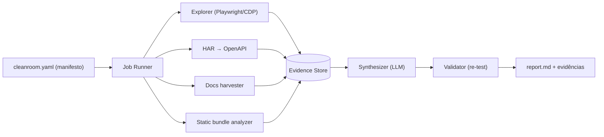

# 🧪 kraken-cleanroom

> **Clean room application analyzer.** Dê um link (ou repo/app próprio) e o Kraken estuda a aplicação a fundo - telas, fluxos, rede, documentação pública - e gera uma **especificação funcional limpa**, com regras de negócio rastreáveis a evidências, pronta para ser reimplementada em outra aplicação. **Sem copiar código.**

Parte do ecossistema **Kraken** (KrakenBridge-Web, Paperclip, Antigravity).

---

## O que ele entrega

Um **super relatório** por aplicação analisada:

- Visão do produto, personas, planos e limites
- Mapa funcional (módulos → funcionalidades) com screenshots em 375 / 768 / 1440 px
- Modelo de domínio (entidades, atributos, relacionamentos)
- Catálogo de regras de negócio `BR-NNN` - cada uma com evidência e nível de confiança
- Máquinas de estado, fluxos principais (diagramas de sequência)
- Contrato de API inferido (OpenAPI 3.1)
- Matriz de papéis/permissões, validações e mensagens
- Critérios de aceite em Gherkin (viram a suíte de testes da reimplementação)
- Lacunas e hipóteses não confirmadas

## Como funciona (resumo)

## Status

🚧 **Fase 0 - Documentação & bootstrap.** A implementação segue o roadmap em [`docs/11-roadmap-e-backlog.md`](docs/11-roadmap-e-backlog.md).

## Documentação

Comece por [`AGENTS.md`](AGENTS.md) (para agentes de IA e humanos) e depois [`docs/README.md`](docs/README.md).

## Princípios inegociáveis

1. **Clean room de verdade** - o relatório descreve *comportamento*, nunca contém código, assets ou textos proprietários copiados.
2. **Autorização explícita** - nenhum job roda sem um `cleanroom.yaml` válido.
3. **Sem bypass** - CAPTCHA, SMS, paywall e pagamentos são sempre *handoff humano*. Nunca contornar controles de acesso.
4. **Evidência ou não aconteceu** - toda afirmação do relatório aponta para uma evidência e um nível de confiança.

## Licença

MIT
