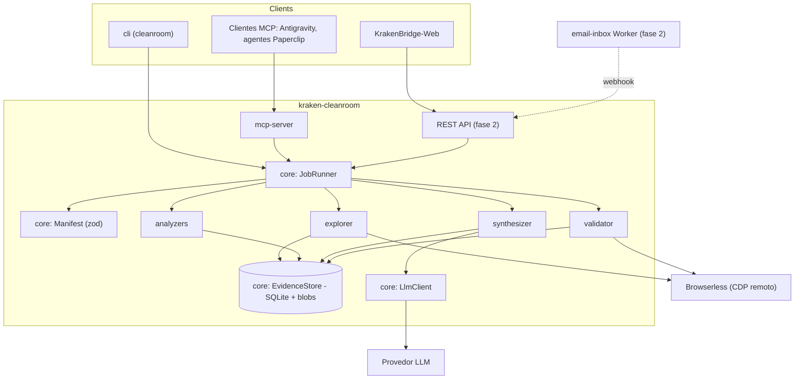
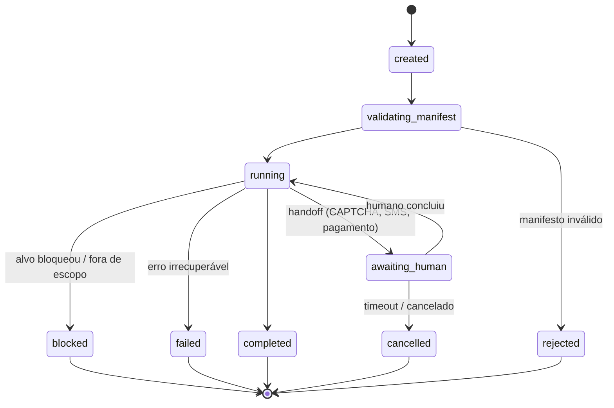

# 02 - Arquitetura

## 1. Decisão central

`kraken-cleanroom` é um **serviço standalone** (container no servidor Dell), com um núcleo único exposto por **MCP**, **CLI** e uma **API REST mínima**. Paperclip, KrakenBridge-Web e Antigravity são **clientes finos**. Nenhum desses sistemas hospeda a lógica do pipeline.

Alternativas rejeitadas:

| Alternativa | Por que não |
|---|---|
| Implementar dentro do Paperclip | Paperclip é fork de upstream (conflitos de merge); heartbeats curtos de agentes não combinam com jobs de minutos a horas com browser aberto |
| Plugin do KrakenBridge-Web | Prende a uma UI; agentes do Paperclip não teriam acesso |
| Rust/Go por performance | Gargalo é I/O (browser remoto, LLM, rede, humano). TS tem Playwright e MCP SDK de primeira classe |

## 2. Visão de componentes



## 3. Pacotes e responsabilidades

| Pacote | Responsabilidade | Depende de |
|---|---|---|
| `@cleanroom/core` | Tipos compartilhados, schema do manifesto, `JobRunner`, `EvidenceStore`, `LlmClient`, logger, config | - |
| `@cleanroom/explorer` | Conexão CDP, crawler, state graph, screenshots multi-viewport, captura HAR, form probing, guardas de escopo | core |
| `@cleanroom/analyzers` | `harToOpenApi`, `docsHarvester`, `bundleAnalyzer` | core |
| `@cleanroom/synthesizer` | Evidências -> achados -> regras `BR-NNN` -> domínio -> relatório | core |
| `@cleanroom/validator` | Re-executa cenários derivados das regras e atualiza confiança | core, explorer |
| `@cleanroom/mcp-server` | Ferramentas `cleanroom_*` (stdio e HTTP streamable) | core + todos |
| `@cleanroom/cli` | Binário `cleanroom` | core + todos |

Regra de dependência: **pacotes de fase nunca importam uns aos outros**, exceto `validator -> explorer`. Comunicação entre fases é pelo `EvidenceStore` e pelos artefatos do job.

## 4. Modelo de execução do job

- Um job é uma **máquina de estados** persistida em SQLite (tabela `jobs`, coluna `state`).
- Cada fase é uma função `async run(ctx: PhaseContext): Promise<PhaseResult>` idempotente e **retomável**: ao reiniciar o serviço, o `JobRunner` retoma da última fase não concluída.
- Pausas (`awaiting_human`) liberam o browser e persistem `storageState` para retomada.



Fases (ordem padrão; cada uma pode ser desligada pelo manifesto):

`intake -> explore -> capture -> analyze -> synthesize -> validate -> report`

Detalhes de entrada/saída em [04-pipeline-e-fases.md](04-pipeline-e-fases.md).

## 5. Layout de dados de um job

```
${CLEANROOM_DATA_DIR}/jobs/<jobId>/
  manifest.yaml            # cópia imutável do manifesto validado
  job.json                 # snapshot do estado (espelho do SQLite)
  browser/storage-state.json   # sessão (fase 2), NUNCA vai para o relatório
  evidence/
    screenshots/<sha256>.png
    har/<phase>-<n>.har        # já sanitizado (sem cookies/tokens)
    dom/<sha256>.html          # snapshot reduzido (sem scripts inline)
    docs/<sha256>.md           # docs públicas convertidas em markdown
    bundles/<sha256>.json      # metadados extraídos (rotas, strings), não o bundle bruto
  graph/state-graph.json
  analysis/openapi.yaml
  analysis/strings.json
  findings.json
  report/report.md
  report/features/*.feature
  report/assets/               # screenshots referenciados pelo relatório
logs/job.ndjson
```

Banco: `${CLEANROOM_DATA_DIR}/cleanroom.db` com tabelas `jobs`, `phases`, `evidence`, `findings`, `rules`, `handoffs`, `events`. Schema em [05-evidencias-e-relatorio.md](05-evidencias-e-relatorio.md) §3.

## 6. Escolhas tecnológicas

| Escolha | Motivo |
|---|---|
| Node 22 + TS strict + ESM | Ecossistema Playwright/MCP; alinhado com KrakenBridge-Web e Paperclip |
| `playwright-core` + `chromium.connectOverCDP` | Browser remoto no Browserless; zero Chrome local |
| `better-sqlite3` | Síncrono, rápido, arquivo único, fácil backup; suficiente para 1 serviço |
| Blobs em disco por SHA-256 | Dedup natural de screenshots/HAR; DB fica leve |
| `zod` | Schema do manifesto, validação de saída de LLM, contratos MCP |
| LLM via interface `LlmClient` | Provedor plugável (`CLEANROOM_LLM_PROVIDER`), saída estruturada validada por zod |
| `pino` | Logs JSON por job |

## 7. Configuração (variáveis de ambiente)

Ver `.env.example`. Principais:

| Variável | Obrigatória | Descrição |
|---|---|---|
| `CLEANROOM_DATA_DIR` | sim | Raiz dos dados (`./data` em dev) |
| `CLEANROOM_BROWSER_WS_ENDPOINT` | sim (fases com browser) | WebSocket CDP do Browserless, com token |
| `CLEANROOM_LLM_PROVIDER` | sim (synthesize) | `openai`, `anthropic`, `gemini` ou `openai-compatible` |
| `CLEANROOM_LLM_MODEL` | sim | Id do modelo |
| `CLEANROOM_LLM_API_KEY` | sim | Chave do provedor |
| `CLEANROOM_LLM_BASE_URL` | não | Para provedores compatíveis com OpenAI |
| `CLEANROOM_MAX_CONCURRENT_JOBS` | não (default 1) | Jobs simultâneos |
| `CLEANROOM_HTTP_PORT` | não (default 4870) | Porta REST/MCP HTTP |
| `CLEANROOM_NOTIFY_WEBHOOK_URL` | não | Webhook de handoff (fase 2) |

## 8. Observabilidade

- Log NDJSON por job com `jobId`, `phase`, `event`, `durationMs`.
- Tabela `events` alimenta `cleanroom_status` (progresso por fase, contadores de evidências/achados).
- Custo de LLM (tokens in/out) registrado por chamada e somado por job.
