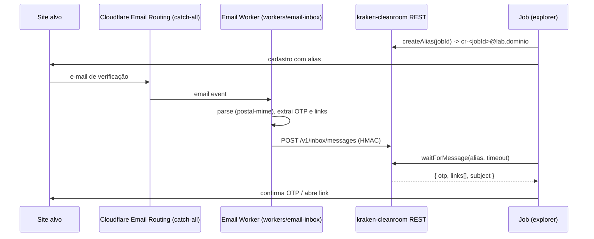

# 06 - Contas de teste, e-mail e handoff humano

> Escopo da **Fase 2** do roadmap. Não implementar antes da Fase 1 estar concluída.

## 1. Política

- **Uma** conta por job, criada com a **identidade real do dono** do homelab. Não existe suporte a identidades falsas ou criação em massa.
- Os termos de uso do alvo foram revisados (`authorization.tosReviewed: true`).
- CAPTCHA, SMS e pagamento são **sempre** `handoff` humano ou `abort`. Proibido integrar solvers de CAPTCHA ou serviços de número descartável.
- Ao final, a conta é excluída pelo fluxo oficial do alvo (`cleanup.deleteAccountAtEnd`).

## 2. E-mail: Cloudflare Email Routing + Email Worker

Domínio de inbox: subdomínio dedicado (ex.: `lab.<seu-dominio>`), configurado em `CLEANROOM_INBOX_DOMAIN`. Usar subdomínio protege a reputação do domínio principal.



### `workers/email-inbox`

- Runtime: Cloudflare Workers, TypeScript, `postal-mime` para parse.
- Handler `email(message, env, ctx)`:
  1. Aceitar só destinatários que casem com `^cr-[a-z0-9-]+@` no domínio configurado; demais: `message.setReject("unknown recipient")`.
  2. Extrair: `to`, `from`, `subject`, `text`, links (`https?://` do HTML/texto), candidatos a OTP (regex `\b\d{4,8}\b` próximos de palavras `code|código|verification|verificação|OTP`).
  3. POST para `${CLEANROOM_PUBLIC_URL}/v1/inbox/messages` com header `X-Cleanroom-Signature: sha256=<HMAC(body, INBOX_HMAC_SECRET)>`.
  4. Fallback: se o POST falhar, gravar em KV (`INBOX_KV`) com TTL de 24 h; o serviço faz pull em `/v1/inbox/pull` (opcional).
- Secrets do Worker via `wrangler secret put` (nunca em `wrangler.toml`).
- O endpoint REST é exposto pelo Cloudflare Tunnel já existente no homelab, protegido por HMAC e, opcionalmente, Cloudflare Access service token.

### API interna de inbox (em `@cleanroom/core`)

```ts
interface Inbox {
  createAlias(jobId: string): Promise<string>;
  waitForMessage(alias: string, opts: { timeoutMs: number; subjectMatch?: RegExp }): Promise<InboxMessage>;
  listMessages(alias: string): Promise<InboxMessage[]>;
}
interface InboxMessage {
  id: string; alias: string; from: string; subject: string; receivedAt: string;
  otpCandidates: string[]; links: string[]; textPreview: string; // <= 2k chars
}
```

Mensagens viram evidência `email_received` (útil para regras como "cadastro exige confirmação de e-mail em até 24 h").

## 3. Credenciais

- Senha gerada (24+ caracteres) por job.
- Armazenamento: interface `CredentialStore` com implementações `file-encrypted` (default, AES-256-GCM com chave em `CLEANROOM_CREDENTIALS_KEY`) e `vaultwarden` (opcional, via API Bitwarden).
- Credenciais **nunca** aparecem em logs, evidências, relatório ou memória de agentes. Teste automatizado procura a senha nos artefatos do job e falha se encontrar.

## 4. Sessão

- Após login bem-sucedido: `context.storageState()` salvo em `jobs/<jobId>/browser/storage-state.json` (permissão 600).
- Retomada de job reutiliza a sessão; se expirada, refaz login (sem novo cadastro).

## 5. Handoff humano

```ts
interface HandoffRequest {
  kind: "captcha" | "sms_otp" | "payment_approval" | "manual_login" | "other";
  message: string;          // instrução clara em pt-BR
  liveUrl?: string;         // URL de live view / debugger do Browserless para o humano agir
  timeoutMin: number;
}
```

Fluxo:
1. Fase detecta bloqueio (heurísticas: iframes/`div` de reCAPTCHA, hCaptcha, Turnstile; campo de SMS; página de pagamento).
2. **Não interage** com o desafio. Retorna `{ status: "awaiting_human", handoff }`.
3. Runner persiste `storageState`, mantém (ou recria) a sessão, grava `handoffs` e notifica via `CLEANROOM_NOTIFY_WEBHOOK_URL` (KrakenBridge/WhatsApp) com `jobId`, `kind`, `message`, `liveUrl`.
4. Humano resolve e chama `cleanroom_handoff_resolve` (MCP/CLI/REST).
5. Runner retoma a fase do checkpoint. Timeout -> job `cancelled` com motivo.

## 6. Exclusão de conta

- Fase final opcional `cleanup`: navegar até as configurações de conta, localizar o fluxo de exclusão e executá-lo. Esta é a **única** ação destrutiva permitida, e só sobre a conta criada pelo próprio job.
- Se o fluxo exigir confirmação humana (senha, e-mail), gerar handoff.
- Registrar o comportamento observado como evidência (ex.: "exclusão agendada para 30 dias").
