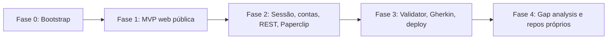

# 11 - Roadmap e backlog

Fonte de tarefas para o Paperclip. **Pai do Kraken**: refine, crie uma sub-issue por story (título `[<ID>] <título>`), respeite dependências e delegue ao **Kraken Forge**; revisão pelo **Kraken Sentinel**.

Convenções:
- Uma story = um PR (salvo indicação). Branch `feat/<ID>-<slug>`.
- Marque `[x]` aqui no mesmo PR que conclui a story.
- `Dep:` lista stories que precisam estar mergeadas antes.
- Tamanho: S (≤ 0,5 dia), M (≤ 1,5 dia), L (≤ 3 dias). L deve ser quebrada se possível.

---

## Fase 0: Bootstrap

### [x] F0-01 Monorepo pnpm + TypeScript + Biome + Vitest (M)
- Criar `package.json` raiz (`private`, `packageManager: pnpm@9`, `engines.node >=22`), `pnpm-workspace.yaml` (`packages/*`, `workers/*`, `fixtures/*`), `tsconfig.base.json` (ver `09` §1), `biome.json`, `vitest.workspace.ts`.
- Criar pacotes vazios com `package.json`, `tsconfig.json`, `src/index.ts`, `tsup.config.ts`: `core`, `explorer`, `analyzers`, `synthesizer`, `validator`, `mcp-server`, `cli`. Nome npm `@cleanroom/<pkg>`.
- Scripts raiz: `build`, `typecheck`, `lint`, `format`, `test`, `cleanroom` (executa CLI compilada).
- **Aceite:** `pnpm install && pnpm lint && pnpm typecheck && pnpm test && pnpm build` passam num clone limpo; teste trivial em `core`.

### [x] F0-02 CI GitHub Actions + gitleaks + PR template (S) - Dep: F0-01
- `.github/workflows/ci.yml` conforme `09` §5. Revisar `.github/pull_request_template.md` (já existe).
- **Aceite:** CI verde no PR; gitleaks falha se um token fake for adicionado (verificar localmente e remover).

### [x] F0-03 Core: config, logger, erros (S) - Dep: F0-01
- `loadConfig()` lendo env com zod (variáveis de `02` §7); `createLogger()` pino com redaction (incluindo `token=` em URLs); hierarquia `CleanroomError`.
- **Aceite:** testes de config inválida com mensagem clara; teste comprovando redaction de `ws://x?token=abc`.

### [x] F0-04 Core: schema do manifesto + `loadManifest` + `ScopeGuard` (M) - Dep: F0-03
- Implementar schema zod completo de `03` (Fase 1 usa todos os campos; `accounts` aceito e validado, mas só `strategy: none` executável até a Fase 2).
- Regras cruzadas de `03` §3 com mensagens em pt-BR.
- `ScopeGuard`: `assertMethod`, `canNavigate(url)` (origins, forbiddenPaths com `picomatch`, robots), `isDestructive(label)`, `throttle()` (token bucket).
- `examples/cleanroom.example.yaml` deve validar.
- **Aceite:** ≥ 20 casos de teste (válidos e inválidos, cada regra cruzada); merge de `forbiddenPaths` padrão garantido.

### [x] F0-05 CLI esqueleto: `init`, `validate`, `doctor` (S) - Dep: F0-04
- `commander`; `init <url>` gera YAML com defaults seguros e comentários; `validate` imprime issues; `doctor` checa data dir gravável, CDP (conecta e abre `about:blank`), LLM (chamada mínima), sem imprimir segredos.
- **Aceite:** `cleanroom init https://demo.playwright.dev/todomvc | cleanroom validate -` passa; `doctor` com env ausente mostra o que falta.

### [x] F0-06 `fixtures/demo-app` (M) - Dep: F0-01
- App de referência própria (Hono + HTML/JS simples, sem framework pesado): home, login fake, lista de "projetos" paginada (API JSON `/api/projects?page=`), detalhe com `status` (`draft|active|archived`) e botões dependentes do status, formulário "Novo projeto" com validações (nome obrigatório 3-60, orçamento ≥ 0, data futura), página `/pricing` (Free: 3 projetos; Pro: ilimitado), `/help` com 3 artigos, `robots.txt`, `sitemap.xml`, rota `/admin` (deve ser evitada).
- `fixtures/demo-app/EXPECTED.md`: lista das regras plantadas (ground truth para testes do pipeline).
- Script `pnpm --filter demo-app start` em porta configurável.
- **Aceite:** app sobe localmente; EXPECTED.md com ≥ 10 regras.

---

## Fase 1: MVP web pública (sem login)

### [x] F1-01 Core: SQLite, migrações, `EvidenceStore` (M) - Dep: F0-03
- Schema de `05` §3; migrador por `PRAGMA user_version`; `EvidenceStore.put()` com dedup por `(job, kind, sha256)` e blobs em disco por hash; `list/get` com paginação por cursor.
- **Aceite:** testes de dedup, retomada, paginação; DB em diretório temporário nos testes.

### [x] F1-02 Core: `JobRunner` + máquina de estados + checkpoints (L) - Dep: F1-01, F0-04
- Estados e transições de `02` §4; execução sequencial das fases habilitadas; persistência de checkpoint; retomada após crash (simular matando o runner no meio da fase em teste); timeout global via `AbortSignal`; eventos em `events`.
- `JobService` (de `07` §1) com `start/status/list/cancel/resume`.
- **Aceite:** testes com fases fake cobrindo ok, awaiting_human, blocked, failed, cancel, resume.

### [x] F1-03 Explorer: sessão CDP + intake (M) - Dep: F1-02
- `BrowserSession` (connectOverCDP, contexto por job, cleanup em finally). Fase `intake` de `04`: fetch, robots, sitemap, detecção SPA/SSR e tecnologias.
- **Aceite:** testes de intake contra demo-app usando fetch (sem browser); teste E2E de conexão CDP com `skipIf`.

### [x] F1-04 Explorer: crawler, fingerprint de estado e state graph (L) - Dep: F1-03
- Algoritmo BFS de `04` Fase 2; fingerprint; extração e classificação de ações; respeito a `maxPages/maxDepth/forbiddenPaths/destructive`; `graph/state-graph.json`.
- **Aceite (E2E demo-app):** descobre home, lista, detalhe, novo projeto, pricing, help; **nunca** visita `/admin` nem clica em botão "Excluir"; grafo serializado válido.

### [ ] F1-05 Explorer: screenshots multi-viewport + snapshots DOM/a11y (M) - Dep: F1-04
- 375/768/1440 por estado novo; DOM reduzido; a11y snapshot; evidências correspondentes.
- **Aceite:** para demo-app, 3 screenshots por estado, dedup por hash; DOM sem `<script>`.

### [ ] F1-06 Explorer: form schema + probing `validation-only` (M) - Dep: F1-04
- Extração de schema de formulários; bateria de valores inválidos; captura de mensagens e 4xx; nunca concluir submissão válida.
- **Aceite:** detecta as 3 validações do formulário "Novo projeto" da demo-app; nenhum projeto criado na API da demo (verificar contador).

### [x] F1-07 Capture: HAR + sanitização + `network_call` (M) - Dep: F1-04
- `recordHar`; sanitização de `04` Fase 3; shapes sem valores.
- **Aceite:** teste unitário de sanitização com HAR fixture contendo cookies/tokens (nenhum sobrevive); evidências `network_call` com `urlTemplate`.

### [ ] F1-08 Analyzer: `harToOpenApi` (M) - Dep: F1-07
- Templating de path, merge de shapes, enums, paginação, auth, `x-cleanroom-evidence`.
- **Aceite:** a partir de HAR fixture da demo-app gera OpenAPI 3.1 válido (validar com `@apidevtools/swagger-parser`), com `GET /api/projects` paginado e enum `status`.

### [x] F1-09 Analyzer: `docsHarvester` + pricing (M) - Dep: F1-02
- Readability + turndown; segmentação; `pricing_plan` estruturado.
- **Aceite:** demo-app `/help` gera 3 `doc_section`; `/pricing` gera 2 planos com limite de projetos.

### [ ] F1-10 Analyzer: `bundleAnalyzer` (M) - Dep: F1-07
- Rotas, strings, flags, endpoints literais; sem armazenar bundle bruto.
- **Aceite:** extrai rotas e mensagens de erro da demo-app; teste garante que nenhum blob > 4 KB de JS é persistido.

### [x] F1-11 Core: `LlmClient` + provedores + `FakeLlmClient` (M) - Dep: F0-03
- Interface `generateObject<T>(schema: ZodType<T>, messages, opts)`, retry em saída inválida, contagem de tokens, provedores `openai-compatible` e `gemini` no MVP (outros depois); fake determinístico.
- **Aceite:** testes com fake; teste de retry; tokens contabilizados no job.

### [ ] F1-12 Synthesizer: módulos, achados, regras, domínio (L) - Dep: F1-11, F1-01
- Pipeline de `04` Fase 5 (etapas 1-5); prompts em `packages/synthesizer/prompts/`; descarte de itens sem evidência; ids `BR-NNN` estáveis.
- **Aceite:** com `FakeLlmClient` e evidências da demo-app, produz regras que cobrem ≥ 70% de `EXPECTED.md`; teste de descarte de claim sem evidência.

### [ ] F1-13 Report: template + renderização + `index.json` (M) - Dep: F1-12
- Renderer de `templates/report-template.md` a partir dos dados; mermaid ER/estado/sequência; assets copiados; checagens de qualidade de `05` §7.
- **Aceite:** golden test do `report.md`; checagem anti-cópia passa; mermaid parseável.

### [ ] F1-14 CLI `run/status/report/evidence/list/cancel/resume` (M) - Dep: F1-02, F1-13
- Conforme `07` §3, com códigos de saída.
- **Aceite:** `cleanroom run examples/demo-app.cleanroom.yaml` completa contra demo-app local com fake LLM (`CLEANROOM_LLM_PROVIDER=fake`).

### [ ] F1-15 MCP server (stdio) (M) - Dep: F1-14
- Ferramentas de `07` §2 (exceto handoff); testes com cliente MCP in-memory do SDK.
- **Aceite:** listar ferramentas, iniciar job na demo-app e obter relatório via MCP em teste.

### [ ] F1-16 Piloto real e ajuste (M) - Dep: F1-15
- Rodar contra `https://demo.playwright.dev/todomvc` e um segundo site público de prática, com LLM real, no homelab. Registrar métricas de `01` §6 em `doc/pilots/<data>-<alvo>.md` (sem screenshots no repo).
- **Aceite:** relatório gerado; lista de ajustes abertos como issues.

---

## Fase 2: Sessão, contas, REST, Paperclip

- [ ] F2-01 REST API Hono + auth + SSE de eventos (M) - Dep: F1-15
- [ ] F2-02 MCP via Streamable HTTP (S) - Dep: F2-01
- [ ] F2-03 Handoff humano: detecção de desafios, persistência, notificação webhook, resolve (L) - Dep: F2-01
- [ ] F2-04 `CredentialStore` (file-encrypted) + teste anti-vazamento de senha (M) - Dep: F1-01
- [ ] F2-05 `workers/email-inbox` (Cloudflare Worker) + endpoint `/v1/inbox/messages` com HMAC (L) - Dep: F2-01
- [ ] F2-06 Fluxo de cadastro/login com conta única + `storageState` + `authenticatedSession` (L) - Dep: F2-03, F2-04, F2-05
- [ ] F2-07 Fase `cleanup` (exclusão de conta própria) (M) - Dep: F2-06
- [ ] F2-08 Skill Paperclip `kraken-cleanroom` + definição do agente Kraken Cartographer (M) - Dep: F2-02

Detalhes técnicos: `06` e `07` §4. Pai do Kraken deve detalhar critérios de aceite destas stories antes de delegar.

## Fase 3: Validator, Gherkin, deploy

- [ ] F3-01 Validator: planos de verificação declarativos a partir de regras (L)
- [ ] F3-02 Validator: execução, atualização de confiança, seção de contradições (M)
- [ ] F3-03 Geração de `.feature` (Gherkin pt-BR) por módulo (M)
- [ ] F3-04 Dockerfile multi-stage + compose (M)
- [ ] F3-05 Deploy no Dell + healthcheck + registro no MCP do Antigravity (S)
- [ ] F3-06 Release: tag `v*` publica imagem no GHCR (S)
- [ ] F3-07 Documentar API para o KrakenBridge-Web (OpenAPI do próprio serviço) (S)

## Fase 4: Gap analysis e repos próprios

- [ ] F4-01 `methods.sourceRepo`: análise de repo próprio (rotas, modelos, validações) como fonte de evidências (L)
- [ ] F4-02 Gap analysis: relatório do alvo x repo destino -> lista de diferenças por módulo (L)
- [ ] F4-03 Geração de backlog (épicos/histórias com critérios de aceite) a partir do gap (M)
- [ ] F4-04 Integração opcional com REA para binários próprios (`ownership: own`) (M)
