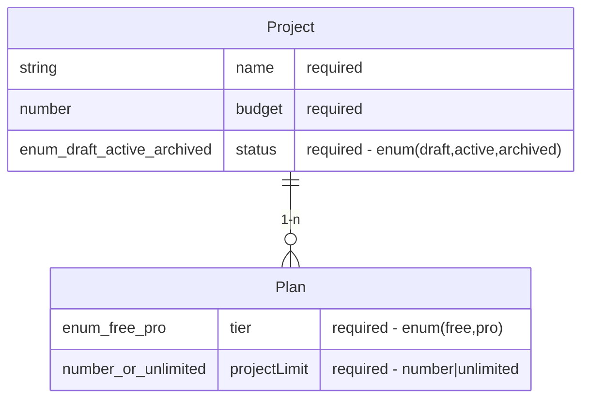
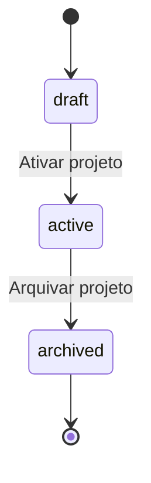
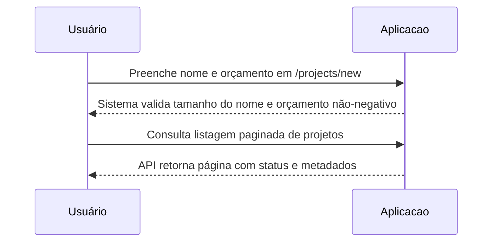

# Relatório clean room: Demo App

| Campo | Valor |
|---|---|
| Alvo | http://localhost:4173 |
| Job | `job_demo_golden_01` |
| Gerado em | 2026-11-22T04:00:00.000Z |
| Ownership | own |
| Métodos | behavioralUi, networkHar, publicDocs, staticBundles |
| Cobertura | 2 estados, 2 endpoints, 1 seções de doc |
| Regras | 3 (2 observed, 0 inferred, 1 hypothesis) |

## 1. Sumário executivo

Aplicação web voltada à gestão de projetos com validações estritas de entrada, máquina de estados de ciclo de vida e limites por plano de assinatura.

**Principais achados**
- Formulário de projetos valida tamanho do nome e orçamento não-negativo (BR-002, BR-003)
- Plano Free limita projetos ativos enquanto o Pro libera criação ilimitada (BR-001)

## 2. Visão do produto

Permite cadastrar, acompanhar e arquivar projetos conforme cotas do plano contratado.

### Personas
- **Usuário Free**: Gerenciar até 3 projetos não arquivados
- **Usuário Pro**: Criar projetos ilimitados e usar pro_export

### Planos e limites
| Plano | Preço | Limites | Evidência |
|---|---|---|---|
| Free | R$ 0/mês | Até 3 projetos | ev_demo_07_pricing |
| Pro | R$ 49/mês | Projetos ilimitados | ev_demo_07_pricing |

## 3. Mapa funcional

### 3.1 Projetos

Gerencia listagem paginada, criação validada e transições de status.

| Funcionalidade | Descrição | Confiança | Evidência |
|---|---|---|---|
| Criação validada | Valida nome (3-60) e orçamento não-negativo no servidor. | observed | ev_demo_04_probe_name, ev_demo_05_probe_budget |

### 3.2 Faturamento e Planos

Define cotas de projetos por plano e habilita exportação Pro.

| Funcionalidade | Descrição | Confiança | Evidência |
|---|---|---|---|
| Cota Free vs Pro | Free permite 3 projetos; Pro remove o teto e libera pro_export. | hypothesis | ev_demo_07_pricing, ev_demo_09_flag |

## 4. Modelo de domínio

### Project
| Atributo | Tipo | Obrigatório | Notas |
|---|---|---|---|
| name | string | sim | - |
| budget | number | sim | - |
| status | enum(draft,active,archived) | sim | - |
### Plan
| Atributo | Tipo | Obrigatório | Notas |
|---|---|---|---|
| tier | enum(free,pro) | sim | - |
| projectLimit | number\|unlimited | sim | - |

## 5. Catálogo de regras de negócio

### BR-001: Limite do Plano Free (3 projetos não arquivados)
- **Módulo:** Faturamento e Planos
- **Quando:** Ao tentar criar um projeto no plano Free
- **Se:** Conta já possui 3 projetos em draft ou active
- **Então:** Criação é bloqueada com HTTP 422
- **Confiança:** hypothesis
- **Evidências:** ev_demo_07_pricing
### BR-002: Validação de tamanho do nome (3 a 60 caracteres)
- **Módulo:** Projetos
- **Quando:** Ao submeter criação de projeto
- **Se:** Nome vazio ou fora da faixa de 3 a 60 caracteres
- **Então:** Requisição rejeitada com HTTP 400 NAME_LENGTH_INVALID
- **Confiança:** observed
- **Evidências:** ev_demo_04_probe_name, ev_demo_08_doc
### BR-003: Orçamento não-negativo (budget >= 0)
- **Módulo:** Projetos
- **Quando:** Ao submeter criação de projeto
- **Se:** Orçamento menor que zero
- **Então:** Requisição rejeitada com HTTP 400 BUDGET_MIN_ZERO
- **Confiança:** observed
- **Evidências:** ev_demo_05_probe_budget

## 6. Máquinas de estado

### Project

## 7. Fluxos principais

### Criação e validação de projeto
Usuário preenche o formulário de novo projeto e recebe validação imediata.

## 8. Contrato de API inferido

Arquivo completo: [`openapi.yaml`](../analysis/openapi.yaml)

| Método | Path | Propósito | Auth | Evidência |
|---|---|---|---|---|
| GET | `/api/projects` | Lista projetos paginados com pageSize padrão 2 | público | ev_demo_06_net_list |
| POST | `/api/projects` | Cria projeto após validar nome, orçamento e cota | público | ev_demo_04_probe_name |

## 9. Papéis e permissões

| Papel / Plano | Permissões observadas | Restrições | Evidência |
|---|---|---|---|
| Usuário Free | Criar até 3 projetos | Sem acesso a /admin | ev_demo_07_pricing, ev_demo_01_robots |
| Usuário Pro | Projetos ilimitados e pro_export | Sem acesso a /admin | ev_demo_07_pricing, ev_demo_09_flag |

## 10. Validações e mensagens

| Formulário | Campo | Regra | Mensagem (resumo) | Evidência |
|---|---|---|---|---|
| /projects/new | name | NAME_LENGTH_INVALID | O nome do projeto deve ter entre 3 e 60 caracteres. | ev_demo_04_probe_name |
| /projects/new | budget | BUDGET_MIN_ZERO | O orçamento deve ser maior ou igual a 0. | ev_demo_05_probe_budget |

## 11. Integrações externas detectadas

- **pro_export** (feature_flag): Feature flag pro_export detectada no bundle público [ev_demo_09_flag]

## 12. Critérios de aceite

_Nenhum arquivo `.feature` gerado neste job (geração Gherkin prevista para a Fase 3)._

## 13. Lacunas, hipóteses e contradições

- **hypothesis**: BR-001 (Limite do Plano Free (3 projetos não arquivados)): inferida apenas por documentação/bundle, sem confirmação na UI/rede [ev_demo_07_pricing]
- **hypothesis**: Faturamento e Planos: Plano Free restringe a conta a 3 projetos ativos ou em rascunho. [ev_demo_07_pricing]

## Apêndice A: cobertura e metodologia

- Limites atingidos: 1 fora de escopo, 1 destrutiva(s) evitada(s)
- Duração: 1.5 min · Tokens LLM: 500 in / 200 out
- Fases executadas: intake, explore, capture, analyze, synthesize, report
- Metodologia: exploração comportamental, captura da própria sessão, documentação pública e metadados de bundles públicos. Nenhum código do alvo foi copiado.
